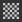
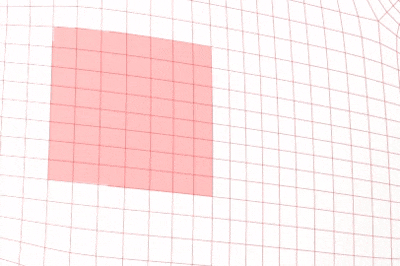

# 다각형 채우기

**다각형 채우기** 도구는 다각형을 재질 채널 값 또는 회색 음영 마스크 값으로 채웁니다. 레이어 페인팅, 효과 및 마스크에 사용하여 메시 영역을 빠르게 채울 수 있습니다.

이 도구는 선택 도구라기보다는 페인팅 도구에 가깝습니다. 따라서 이 도구를 사용한 후에는 지우개 도구를 통하거나 그 위에 채우기만 하여 지울 수 있습니다.

도구는 도구 모음에서 액세스할 수 있습니다.

## 설정

다음은 **속성** 창을 통해 **다각형 채우기** 도구에서 사용할 수 있는 설정 목록입니다.

### 선택 모드

선택 모드는 메쉬 형상의 삼각형 및 사각형 선택 방법을 제어합니다.

| **모드** | **설명** |
|---|---|
|  **사각형 선택 윤곽 채우기** | 클릭하고 드래그하여 사각형 선택 영역을 그립니다. **채우기 모드**&#x200B;는 채워진 도형을 정의하고, **히트 테스트**&#x200B;는 포함된 다각형을 정의합니다.    |
|  **다각형 루프 채우기** | 클릭 한 번으로 쿼드의 전체 루프를 채웁니다. 드래그하면 여러 루프가 선택됩니다.    |
|  **부분 다각형 루프 채우기** | 클릭하고 드래그하여 루프의 일부를 채웁니다. 선택은 보조 루프를 따라 확장되어 다각형 패치를 형성할 수 있습니다.    |

### 채우기 모드

**사각형 선택 윤곽 채우기** 모드에서만 사용할 수 있는 채우기 모드는 도형의 선택된 부분을 제어합니다.

| **모드** | **설명** |
|---|---|
|  **삼각형 채우기** | 개별 메시 삼각형을 채웁니다. |
|  **다각형 채우기** | 전체 다각형을 채웁니다. 가져오기 전에 삼각측정된 메쉬에서 결과는 **삼각형 채우기**&#x200B;와 같습니다. |
|  **메시 채우기** | 클릭한 선에 연결된 모든 다각형을 칠합니다. |
|  **UV 청크 채우기** | UV 공간에서 연결된 다각형을 채웁니다. UV 테두리에서 채우기가 중지됩니다. |

### 히트 테스트

적중 테스트 설정은 **사각형 선택 윤곽 채우기** 모드에서 삼각형과 쿼드를 선택하는 방법을 제어합니다.

| **모드** | **설명** |
|---|---|
|  **교차** | (기본값) 다각형의 형상 부분이 선택 영역 내부에 있거나 이와 교차하는 경우에는 다각형이 채워집니다. |
|  **포함된 가운데** | 다각형은 해당 중심점이 선택 영역 내부에 있는 경우에만 채웁니다. |
| **보이는 다각형만** | 이 옵션을 활성화하면 현재 카메라 보기에서 볼 수 있는 다각형에만 채우기가 적용됩니다. 폐색된 다각형과 뒤쪽을 향한 다각형은 무시됩니다. 비활성화된 경우 다각형을 메시로 채울 수 있습니다. |

### 혼합

이러한 설정은 칠 결과가 밑에 있는 픽셀과 혼합되는 방식을 제어합니다.

| **매개 변수** | **설명** |
|---|---|
| 혼합 모드 | 칠이 기존 픽셀 값과 혼합되는 방식을 제어합니다. **재질** 모드에서 혼합 모드는 **재질** 섹션에서 활성화된 모든 채널에 적용됩니다. |
| 불투명도 | 칠의 불투명도를 제어합니다. |

>[!NOTE]
>
> 이 도구는 레이어 스택에서 사용할 수 있는 것과 동일한 혼합 모드를 지원합니다. 자세한 내용은 [혼합 모드 설명서 페이지](https://experienceleague.adobe.com/ko/docs/substance-3d-painter/using/interface/layer-stack/blending-modes)를 참조하십시오.

### 재질

재질 섹션은 도구로 페인트할 수 있도록 설정할 수 있는 채널을 제어합니다.

## 단축키

다각형 채우기 도구는 특정 키보드 단축키를 사용하여 효율적으로 사용할 수 있습니다.

| **단축키** | **설명** |
|---|---|
| **Alt** | **다각형 루프 채우기** 및 **부분 다각형 루프 채우기**&#x200B;을 사용하면 이 단축키는 드래그하는 동안 처음 클릭의 반대쪽에서 선택 영역을 확장합니다.    |
| **Shift** | **부분 다각형 루프 채우기**&#x200B;를 사용하면 이 단축키는 보조 루프를 무시하고 기본 루프만 채웁니다. **Shift** 전환 예:    |
| **Shift + A** | 이 단축키는 다른 선택 모드에서 **다각형 루프 채우기**(으)로 일시적으로 전환됩니다. 마우스 버튼보다 먼저 단축키를 놓은 경우 마우스 버튼을 놓을 때까지 선택 영역이 계속됩니다. |
| **A** | 드래그하는 동안 이 단축키를 누르면 현재 결과가 이전 결과와 결합됩니다. 이는 혼합 모드와 불투명도에 걸쳐 작동합니다.    |

## 제한 사항

이 도구에는 다음과 같은 몇 가지 제한 사항이 적용됩니다.

* **다각형 루프 채우기** 및 **부분 다각형 루프 채우기**&#x200B;는 쿼드에서만 작동하므로 이러한 모드로 삼각형과 n형을 채울 수 없습니다.
* **방사형 대칭** 지원도 제한되어 있으며 불안정할 수 있습니다. 대칭을 사용하려면 미러 모드를 대신 사용합니다. 자세한 내용은 [대칭 설명서 페이지](https://experienceleague.adobe.com/ko/docs/substance-3d-painter/using/painting/symmetry/symmetry)를 참조하십시오.
* 도구는 **활성 텍스처 집합**&#x200B;의 지오메트리만 채웁니다. 해당 텍스처 세트의 와이어프레임이 표시되고 활성 텍스처 세트가 변경되면 업데이트됩니다.
