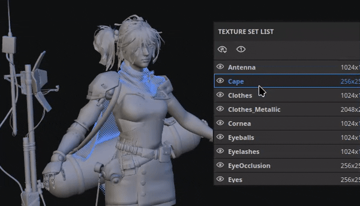
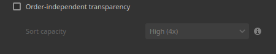

# 버전 12.2

**Substance 3D Painter 12.2**&#x200B;에서는 루프 기반 선택, 굽기를 위한 케이지 페인팅, 뷰포트에서 텍스처 세트 강조 표시, 실시간 렌더링을 위한 순서 독립적인 투명도를 제공하는 개선된 다각형 채우기 도구를 제공합니다.

출시일: **2026년 10월 21일**

## 주요 기능

### 개선된 다각형 채우기

**다각형 채우기** 도구가 다각형 루프를 위한 새 인터페이스 및 새 선택 모드로 다시 작업되었습니다. 이제 이 도구는 불투명도 컨트롤로 혼합 모드를 지원하며 한 번에 여러 채널에서 작업할 수 있습니다. 선택 핸들 오클루전 역시 마찬가지입니다. 즉, 카메라에서 숨겨진 다각형은 무시됩니다.

* **향상된 인터페이스**

  **속성** 창의 **다각형 채우기** 설정이 더 쉽게 사용할 수 있도록 재작업되었습니다. 이제 옵션이 단추 행으로 표시되어 모드 간 전환이 더 빨라졌습니다. 새로운 도구 설명 아이콘은 각 모드의 작동 방식을 설명합니다.

  

* **새 선택 모드**

  다각형 루프 전용 두 가지 새 모드가 **선택 모드** 행에 추가되었습니다.

  

  * **다각형 루프 채우기**: 이 모드는 한 번의 클릭으로 쿼드의 전체 루프를 채웁니다. 드래그하는 동안 **Alt**&#x200B;를 눌러도 선택 영역이 반대 방향으로 확장됩니다.

    

  * **부분 다각형 루프 채우기**: 이 모드는 루프의 일부만 채우고 루프를 따라 드래그하면 선택 영역이 확장됩니다. 드래그하는 동안 화살표는 선택 영역의 각 측면에 토폴로지 흐름을 표시하여 예기치 않은 경로 변경을 예상할 수 있도록 합니다. 커서 옆에 표시된 도구 설명에는 두 축에서 모두 선택된 다각형의 개수가 표시됩니다. 드래그하는 동안 **Alt**&#x200B;를 눌러도 선택 영역이 반대 방향으로 확장됩니다.

    

  **Shift + A**&#x200B;을 누르고 있으면 모든 선택 모드에서 **다각형 루프 채우기**(으)로 일시적으로 전환됩니다. 마우스 버튼보다 먼저 단축키를 놓은 경우 마우스 버튼을 놓을 때까지 선택 영역이 계속됩니다.

* **채우기 모드는 선택 모드를 전환합니다**

  **채우기 모드** 옵션은 **다각형 루프 채우기** 및 **부분 다각형 루프 채우기** 모드에 적용되지 않습니다. 따라서 채우기 모드를 선택하면 **선택 모드**&#x200B;가 다시 기본 모드로 자동 변경됩니다.

  

* **새로운 히트 테스트 옵션**

  새로운 **히트 테스트** 옵션은 선택 영역에 포함되는 다각형을 제어합니다. 기본적으로 **보이는 다각형만** 옵션이 활성화되었으므로 보이지 않는 다각형 제거가 이제 기본 동작입니다. 이 옵션을 비활성화하면 메쉬를 통해 칠하던 이전 동작이 복원됩니다.

  사용 가능한 옵션은 다음과 같습니다.

  * **교차**: (기본값) 다각형의 일부가 선택 영역 내부에 있거나 다각형의 가장자리를 가로지르는 경우 채워집니다.
  * **포함된 중심**: 다각형은 해당 중심점이 선택 영역 내부에 있는 경우에만 채워집니다.
  * **보이는 다각형만**: 활성화되면 이 옵션은 현재 카메라 보기에서 보이는 다각형만 채웁니다. 따라서 폐쇄되고 뒤쪽을 향한 형상은 무시됩니다.

  

* **혼합 모드 및 불투명도**

  **다각형 채우기** 도구는 이제 모든 혼합 모드를 지원하며, 레이어 스택에서 사용할 수 있는 것과 동일한 목록을 제공합니다. 예를 들어 **선형 닷지(추가)**&#x200B;은 기존 값을 바꾸는 대신 기존 값에 값을 추가합니다. 모드는 **불투명도** 슬라이더 외에 **속성** 창의 새 **혼합** 섹션에서 사용할 수 있습니다. **재질** 모드에서 혼합 모드는 **재질** 섹션에서 활성화된 모든 채널에 적용됩니다.

  

* **한 번에 여러 채널 채우기**

  **다각형 채우기** 도구는 더 이상 단일 채널로 제한되지 않습니다. 이제 **재질** 섹션에서 활성화된 모든 채널 속성을 설정하고 한 번의 작업으로 채울 수 있습니다.

  

* **대칭과 호환**

  **다각형 루프 채우기** 및 **부분 다각형 루프 채우기**&#x200B;는 대칭 작업에서도 작동합니다. 한 번의 클릭으로 미러 대칭을 사용할 수 있습니다(방사형 대칭의 안정성은 떨어질 수 있음).

  

* **이전 선 다시 시작**

  **이전 선 다시 시작** 단축키(**A**&#x200B;을 누른 상태로 유지)는 이제 여러 혼합 모드와 불투명도를 포함하여 **다각형 채우기** 도구에서 작동합니다.

  

* **텍스처 집합에서 보다 명확한 피드백**

  이제 활성 텍스처 세트에만 와이어프레임이 표시되고 선택 항목이 변경되면 업데이트됩니다. 이제 다른 텍스처 세트에서 형상을 가리키면 관련 형상을 채울 수 없음을 나타내는 금지된 커서가 표시됩니다.

  

>[!NOTE]
>
> **다각형 채우기** 도구에 대한 자세한 내용은 [전용 문서 페이지](https://experienceleague.adobe.com/ko/docs/substance-3d-painter/using/painting/paint-tools/polygon-fill)를 참조하세요.

### 베이킹 모드에서 새 케이지 페인팅

새로운 **케이지 페인팅 모드**&#x200B;는 픽셀 당 케이지 오프셋으로, 전체 거리 오프셋 위에 페인팅할 수 있습니다. 이제 메시에 직접 페인트하여 케이지를 조정할 수 있습니다. 높은 폴리 메쉬가 케이지 밖으로 나가는 영역은 그런 다음 더 쉽게 로컬로 고정될 수 있다.

* **케이지 오프셋의 새 페인팅**

  [베이킹] 모드의 새 **페인트 케이지** 버튼이 이제 케이지 페인팅 모드로 전환됩니다. 이 모드에서는 **페인트**, **지우개** 및 **다각형 채우기** 도구를 사용하여 낮은 폴리 메쉬로부터 케이지 거리를 조정할 수 있습니다.

  

  이 작업은 중간 텍스처를 페인팅하여 수행합니다. 그런 다음 이 텍스처는 베이킹 중에 케이지 메쉬에 대한 오프셋으로 사용됩니다. 이는 **기울이기 페인팅** 프로세스와 유사합니다.

  상단 도구 모음의 **강도** 매개 변수는 획이 적용하는 오프셋 값을 설정합니다. 일반적인 **크기**, **플로우**, **선 불투명도** 및 **간격** 컨트롤과 **값 반전** 단추도 사용할 수 있습니다. 대칭도 지원됩니다.

  

  

* **다각형 채우기를 사용하여 전체 메시 부분을 선택하고 채웁니다**

  **다각형 채우기** 도구는 한 번에 부분 또는 전체 하위 개체의 케이지 거리를 조정할 수 있습니다. 요소를 클릭하면 **케이지 강도** 슬라이더가 있는 부동 도구 모음이 열립니다. 이 슬라이더는 상단 도구 모음에 설정된 값부터 시작하여 실시간으로 케이지를 늘리거나 줄입니다. 페인팅된 오프셋은 오프셋 위에 추가됩니다.

  

* **뷰포트에서 케이지 오프셋 시각화**

  케이지 페인팅 모드로 전환하면 뷰포트가 새 뷰 모드로 전환됩니다. 이 모드에서는 오프셋이 케이지 위에 녹색 오버레이로 표시됩니다. 케이지는 또한 베이킹 공정 동안 사용되는 케이지 메쉬를 나타내도록 변형된다.

  

  몇 가지 설정은 **베이킹 시각화** 패널을 통해 제어할 수 있습니다. **케이지** 섹션은 **케이지 표면** 및 **케이지 와이어프레임** 디스플레이와 불투명도를 제어합니다. 또한 **오프셋 격자 불투명도**&#x200B;와 **오프셋 음영 강도**&#x200B;가 있습니다.

  

* **상황별 도구 모음의 혼합 모드**

  편의를 위해 컨텍스트 도구 모음 내에서 직접 사용할 수 있는 몇 가지 혼합 모드가 있습니다. 케이지 오프셋을 보다 쉽게 조정하는 데 사용할 수 있습니다. 특히 오프셋을 추가하거나 빼는 데 사용합니다.

  사용 가능한 모드는 다음과 같습니다.

  * **표준**: 기존 오프셋을 선 값으로 바꿉니다.
  * **밝게(최대)**: 선의 높은 값과 기존 오프셋을 유지합니다.
  * **선형 닷지(추가)**: (기본값) 기존 오프셋에 선 값을 추가합니다.

  

  뷰포트에서 마우스 오른쪽 버튼 클릭 메뉴를 사용하여 **다각형 채우기**&#x200B;에서 추가 혼합 모드를 사용할 수 있습니다.

* **케이지 및 기울이기 페인팅을 위한 새로운 재설정 메뉴**

  이제 기울이기 및 케이지 페인팅 모드 모두에 설정을 재설정하는 새로운 메뉴가 있습니다. 사용 가능한 옵션은 다음과 같습니다.

  * **케이지/기울이기 매개 변수 다시 설정**: UI 매개 변수를 기본값으로 다시 설정합니다.
  * **모든 케이지/기울이기 페인트 선 지우기**: 케이지 또는 기울이기 페인팅에 사용된 텍스처를 지웁니다.
  * **모두 재설정 및 지우기**: UI 재설정 및 케이지/기울이기 텍스처 지우기 모두를 결합합니다.

  

>[!NOTE]
>
> 굽기에 대한 자세한 내용은 [전용 문서 페이지](https://experienceleague.adobe.com/ko/docs/substance-3d-painter/using/baking/baking)를 참조하세요.

### 뷰포트에서 강조표시된 새 텍스처 세트

이제 새로운 강조 표시 동작을 통해 3D 뷰포트에서 **텍스처 세트** 또는 **UV 타일**&#x200B;와 연결된 형상을 식별할 수 있습니다.

* **텍스처 집합 목록에서 강조 표시**

  **텍스처 집합 목록**&#x200B;에서 항목을 마우스로 가리키면 이제 해당 항목이 뷰포트에서 텍스처 집합과 UV 타일 모두에 대해 강조 표시됩니다. 이렇게 하면 각 텍스처 세트에 속한 메시 부분을 쉽게 확인할 수 있습니다.

  

* **뷰포트에서 강조 표시**

  모델 위에 **Ctrl/Cmd + Alt**&#x200B;를 놓으면 커서 아래의 텍스처 세트 형상이 강조됩니다. 마우스 왼쪽 버튼을 누르거나 이동하는 동안 강조 표시가 숨겨지고 수정자를 놓으면 다시 표시됩니다.

* **페인팅 및 베이킹 모드에서 사용 가능**

  하이라이트는 페인팅 모드와 베이킹 모드 모두에서 작동합니다. 베이킹 모드에서 비활성화된 텍스처 세트는 강조 표시되면 회색으로 표시됩니다.

### 새로운 순서 독립 투명도

이제 실시간 뷰포트가 순서 독립적인 투명도를 지원합니다. 이 기능으로 여러 개의 투명 또는 반투명 표면이 겹칠 때 나타날 수 있는 정렬 아티팩트와 깜박임을 제거합니다.

* **표시 설정의 새 옵션**

  **순서 독립 투명도** 옵션은 **표시 설정**&#x200B;의 **렌더링 설정** 섹션 내에서 활성화할 수 있습니다. 성능에 영향을 주지 않도록 기본적으로 비활성화되어 있습니다.

  

  새 설정을 활성화하기 전과 활성화한 후:

  

* **성능 제어**

  **정렬 용량** 매개 변수는 픽셀당 정렬할 수 있는 투명도 레이어의 평균 수를 제어합니다. 값이 높을수록 복잡한 장면의 투명도 품질이 향상되지만 더 많은 메모리를 사용하고 성능을 저하시킬 수 있습니다. 사용 가능한 옵션은 다음과 같습니다.

  * **낮음(1x)**.
  * **중간(2x)**.
  * **높음(4x)**(기본값)
  * **매우 높음(8x)**
  * **Ultra(16x)**

### 기타 개선 사항

이 버전에 추가 기능 및 개선 사항이 추가되었습니다.

* **다시 구성된 표시 설정**

  **디스플레이 설정** 창의 매개 변수가 다시 그룹화되고 순서가 변경되어 더 쉽게 탐색할 수 있습니다. 이제 설정이 **환경 설정**, **카메라 설정**, **포스트 효과**, **렌더링 설정** 및 **시각화 설정**&#x200B;으로 분할됩니다. 창 위쪽에 있는 일련의 버튼을 사용하면 각 그룹으로 바로 이동할 수 있습니다.

  

* **브러시 획을 사용한 추가 혼합**

  이제 브러시 설정에서 새로운 추가 혼합 모드를 제공합니다. 이 모드에서는 선이 서로 바뀌지 않고 동일한 레이어에서 서로 위에 추가됩니다. 이는 획 내부의 스탬프에만 국한되지 않습니다. 이 새로운 모드 색상을 추가로 추가하거나 값을 추가하거나 제거하여 Height 채널을 조각할 수 있습니다.

  

* **새 UV 인접 엔진 맵**

  Substance 재질 및 필터에 대해 새 `mesh_uv_neighbor` 엔진 맵 입력을 사용할 수 있습니다. 그것은 UV 섬 솔기의 다른 면을 찾기 위해 UV 이류 텍스처로 작동합니다. 이의 적색 및 녹색 채널은 UV 이음새를 가로질러 이웃하는 픽셀에 도달하는데 사용되는 UV 이류를 저장한다.

  이러한 엔진 텍스처에 대한 자세한 내용은 [전용 문서 페이지](https://experienceleague.adobe.com/ko/docs/substance-3d-painter/using/content/creating-custom-effects/mesh-based-input)를 참조하세요.

## 릴리스 정보

### 12.2.0

출시일: **2026/10/21**

요약: **이 업데이트는 주요 릴리스이며 베이킹을 위한 새로운 케이지 페인팅 기능을 추가하고 다각형 채우기 기능을 개선합니다. 자세한 내용은 전체 릴리스 정보를 참조하십시오.**

**추가됨:**

* 베이킹, 케이지 페인팅
* &lbrack;케이지 페인팅&rbrack; 기본 케이지 페인트 UI 만들기
* &lbrack;케이지 페인팅&rbrack; 새로운 케이지 시각화 옵션
* &lbrack;케이지 페인팅&rbrack; 편집 가능한 선택/채우기 도구
* &lbrack;케이지 페인팅(&amp;r); 도구 모음에서 혼합 모드 표시
* &lbrack;케이지 페인팅&rbrack; HDR 슬라이더 UI 변경 사항
* &lbrack;케이지 페인팅&rbrack; 시각화 셰이더
* &lbrack;케이지 페인팅&rbrack; 스택 재설정 옵션
* 다각형 채우기 도구 개선
* &lbrack;다각형 채우기(&amp;r); 다각형 패치 추가
* &lbrack;다각형 채우기(&amp;r); 다각형 추가 루프
* &lbrack;다각형 채우기(&amp;r); 루프/패치 대칭 지원
* &lbrack;다각형 채우기(&amp;r); 대칭 가장자리 미리 보기
* &lbrack;다각형 채우기&rbrack; 루프 및 부분 루프가 있는 삼각형 제거
* 활성 텍스처 세트에만 표시되는 &lbrack;다각형 채우기&rbrack; 와이어프레임
* &lbrack;다각형 채우기&rbrack; 클릭할 수 없는 삼각형의 빨간색 가장자리 강조
* &lbrack;다각형 채우기&rbrack; 채우기 모드 옵션을 비활성화하지 않음
* &lbrack;다각형 채우기&rbrack; 다각형 채우기를 사용하여 모든 채널 속성 설정 허용
* &lbrack;다각형 채우기&rbrack; 이전 획 다시 시작 다각형 채우기 사용
* &lbrack;다각형 채우기&rbrack; 비활성 텍스처 세트에 금지된 커서 표시
* &lbrack;다각형 채우기(&amp;r); ALT 빠른 미리 보기
* Polyloop로 임시 전환(SHIFT+A)을 위한 &lbrack;Polygon Fill&rbrack; 단축키
* &lbrack;뷰포트(&amp;r); 텍스처 세트 표시 / UV 타일 선택 강조 표시
* &lbrack;Viewport&rbrack; 실시간 뷰포트에서 주문 독립 투명도 지원 추가
* &lbrack;표시 설정&rbrack; 표시 설정을 새 그룹으로 다시 구성
* &lbrack;도구(&amp;r); 브러시 획을 사용한 추가 혼합 지원 추가
* &lbrack;도구(&amp;r); 다각형 칠을 사용한 추가 혼합 지원 추가
* &lbrack;USD&rbrack; 불투명도 맵이 있는 내보낸 USD이 아놀드에서 모든 투명도를 렌더링합니다.
* &lbrack;Nvidia&rbrack; 최신 Nvidia 드라이버에 대한 경고 추가(616.56 ~ 617.14)
* 새 &quot;mesh_uv_neighbor&quot; 엔진 맵 입력 추가
* 베이커를 버전 3.23.0으로 업데이트
* Substance 엔진을 버전 9.6.1로 업데이트

**고정:**

* &lbrack;Baking&rbrack; 앰비언트 오클루전 메쉬 이름별 배경 무시가 작동하지 않음
* &lbrack;Baking&rbrack; &lbrack;AMD&rbrack; 장치가 두꺼운 높은 폴리 메쉬로 굽을 때 손실됨
* &lbrack;성능&rbrack; Painter hogs VRAM 사용
* &lbrack;Viewport&rbrack; HDPI 화면에서 프로젝트를 열 때 누락된 텍스처
* 마스크에서 페인팅할 때 &lbrack;Tool&rbrack; 혼합 모드가 회색으로 표시됩니다.
* 네트워크에서 내보낸 후 임시 폴더가 삭제되지 않음
* &lbrack;USD&rbrack; 내보낸 USD 형상이 UV 테두리를 따라 분할됩니다.
* &lbrack;USD&rbrack; 잘못된 형식의 USDz를 로드할 때 고정
